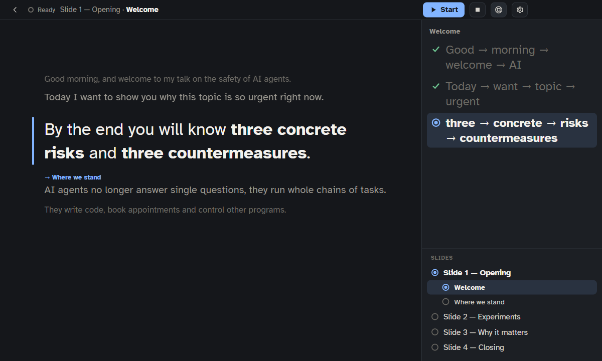

# PresentFlow

**Speak freely. PresentFlow keeps your place.**

PresentFlow is a presentation companion for Windows. It listens while you present, follows your position
in your prepared script (including jumps between sections), and always shows **what to say now**,
**what comes next**, and **what you haven't covered yet**. You lead, it follows.

[](LICENSE)

[](https://github.com/ahmad-alismail/presentflow/releases/latest)

**[Website and live demo](https://ahmad-alismail.github.io/presentflow/)** ·
**[Download](https://github.com/ahmad-alismail/presentflow/releases/latest)** ·
**[Docs](docs/)**



## Features

- **Follows your voice.** Jump to another section and the view follows after a sentence or two.
- **Remembers what's left.** Skipped content stays in its section with an amber dot. It is never forced back on screen.
- **Memory cues from your own words.** Press `R` for a cue like `three → concrete → risks → countermeasures`, press again for the full sentence.
- **Paraphrasing is fine.** Fuzzy word matching plus meaning-based matching, in German and English.
- **PowerPoint sync.** The slide on screen decides what you see. Import a `.pptx` and its speaker notes become your script.
- **Private by default.** Speech recognition runs locally on your GPU (Whisper) and works offline after a one-time model download.

## Install

Download from the [latest release](https://github.com/ahmad-alismail/presentflow/releases/latest):

| File | Use it when |
|---|---|
| `PresentFlow-Setup-<version>.exe` | You want a normal install with a desktop shortcut (recommended) |
| `PresentFlow-Portable-<version>.exe` | You want a single file that runs without installing |

**Requirements:** Windows 10 or 11 (64-bit), a microphone, and ideally a graphics card with WebGPU support.
Without WebGPU a smaller model runs on the CPU.

> [!NOTE]
> The app is not code-signed, so Windows SmartScreen shows "Windows protected your PC" on first launch.
> Click **More info**, then **Run anyway**.

## Quick start

1. Create or import a script (`.md`, `.txt` or `.pptx`), or **open the example** (a short German talk).
2. Press **Rehearse**, then **Start**. The first start downloads the speech model once (about 760 MB).
3. Speak. The highlighted sentence follows you, said sentences move up, and the sidebar is your memory map.
   Progress is saved continuously; reopening a presentation offers to resume where you left off.

## Writing a script

```markdown
# Slide 2 — Experiments          ← slide; the number links it to PowerPoint slide 2
## Test environment              ← section: a group of 3–6 sentences
For our study we built a closed test environment. Twelve agents received office tasks.

## Competition
- Bullet points become single points
```

- `#` starts a slide, `##` a section. With only one heading level, every heading is a section; without
  headings, every paragraph is one.
- Write what you will actually say: full sentences, one idea each, ideally under 25 words. Distinctive
  words (names, numbers, technical terms) help recognition most.
- Every sentence gets an automatic memory cue made only of its own words. Edit any cue in the editor's
  outline. PresentFlow never invents content.
- **Import from PowerPoint:** every visible slide becomes `# Slide N — Title` and its speaker notes become
  the script. PowerPoint does not need to be installed for this.

## PowerPoint sync

With PowerPoint open (slideshow or normal view), PresentFlow follows the slide on screen
(Settings → PowerPoint, on by default):

- **Next slide: Manual** (default): PresentFlow stays on the slide until you click to the next one, in
  PowerPoint or in PresentFlow's slide list. After the last sentence it shows "End of slide · Next: …".
- **Next slide: Automatic**: PresentFlow moves on as soon as you start speaking the next slide.
- Anything you say from other slides is checked off quietly. If a different presentation is open in
  PowerPoint, switch off **Follow PowerPoint**.
- Slides are matched by the number in the heading (`# Slide 6 — …`, `# Folie 6: …`, `6. …`), then by
  title, then by order.

No add-in is needed: a small background PowerShell process reads the current slide through PowerPoint's
automation interface (COM).

## Shortcuts

| Action | Global (works inside PowerPoint) | In the window |
|---|---|---|
| Memory cue (press twice: full sentence) | `Ctrl+Alt+R` | `R`, `Esc` closes |
| Mark current sentence as said | `Ctrl+Alt+N` | `N` |
| Undo last step | `Ctrl+Alt+B` | `U` |
| Lock / unlock the display (Focus Lock) | `Ctrl+Alt+F` | `F` |
| Pause / resume | `Ctrl+Alt+P` | `P` |
| Back to the previous section | `Ctrl+Alt+Z` | `Z` |

In-window keys avoid arrows, Page Up/Down, `B` and `.` because presenter clickers send those. Click a
section or slide in the slide list to move there; click a talking point to mark it as said or reopen it.
Silence never changes anything, and help never opens by itself.

## Speech recognition and privacy

| Provider | Where audio goes | Notes |
|---|---|---|
| **Local** (default) | Stays on this computer | Whisper large-v3-turbo on the GPU via WebGPU; "Fast" (Whisper small) for weaker GPUs; CPU fallback |
| **OpenAI Realtime** | OpenAI | True streaming. Needs your API key |
| **Google Gemini Live** | Google | Dedicated transcription model. Needs your API key |

Cloud providers need an explicit one-time consent. Only speech segments are sent (no silence), plus up to
100 technical terms from your script. API keys are encrypted with Windows DPAPI. If a cloud provider keeps
failing, PresentFlow switches to the local engine.

## Build from source

Requires Node.js 22.12+ on Windows.

```bash
git clone https://github.com/ahmad-alismail/presentflow
cd presentflow
npm install
npm run dev        # run the app
npm test           # unit and scenario tests
npm run dist       # installer + portable exe in release/
```

See [docs/development.md](docs/development.md) for all test commands and
[docs/how-tracking-works.md](docs/how-tracking-works.md) for the tracking engine and architecture.

## Known limitations

- Cloud providers were verified against mock servers that replay the documented protocols, not yet
  against the live services.
- Local Whisper is not a streaming model: partial results arrive about every 0.7–1.4 s. The cloud
  providers stream natively.
- Microsoft Defender security intelligence 1.463.144.0 flagged Electron's official `ffmpeg.dll` as a
  trojan (a known false positive, [electron/electron#51394](https://github.com/electron/electron/issues/51394)).
  Definitions 1.463.153.0 and newer no longer flag it.

## License

[Apache License 2.0](LICENSE)
